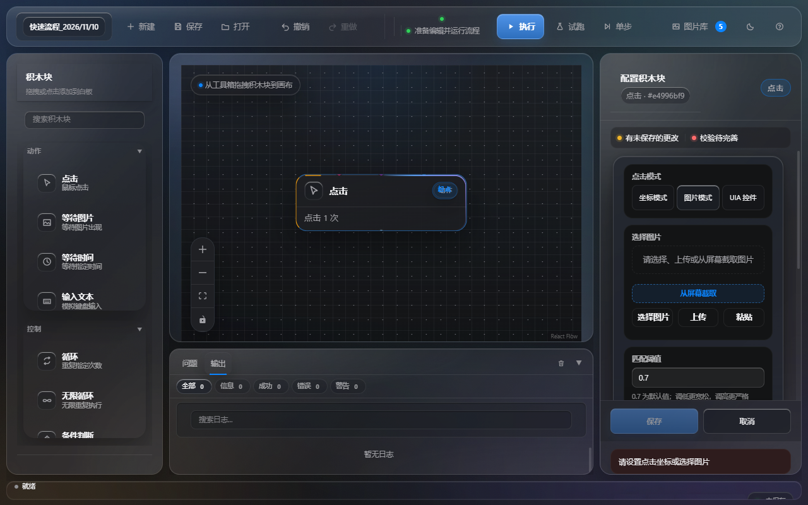
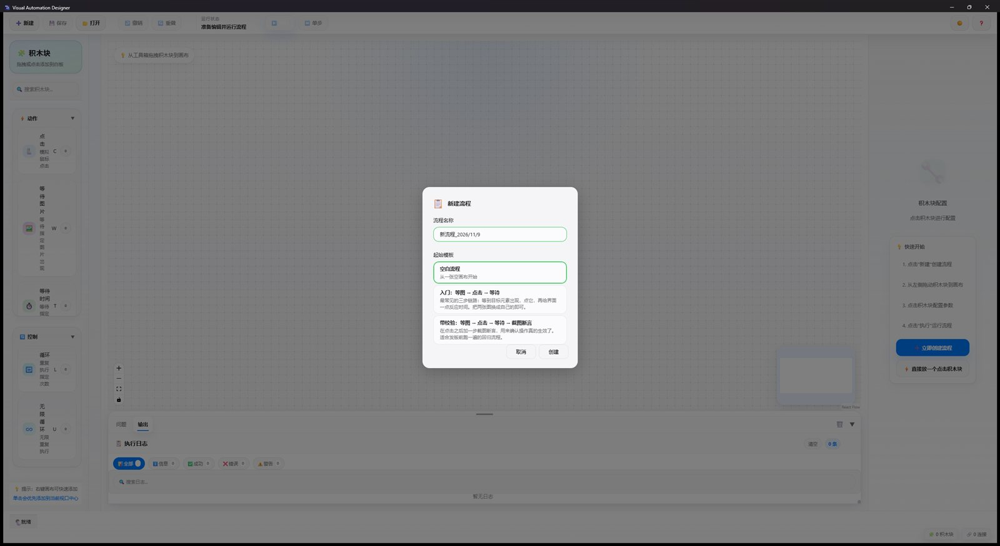
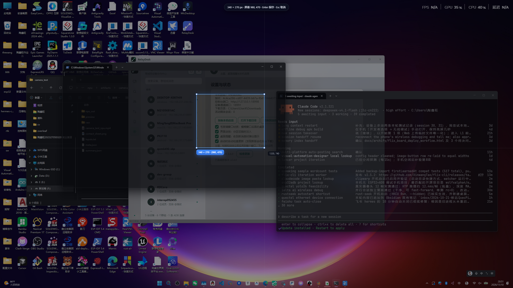
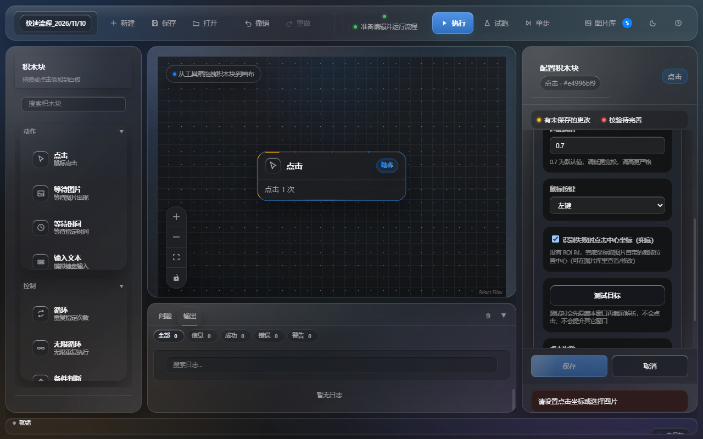
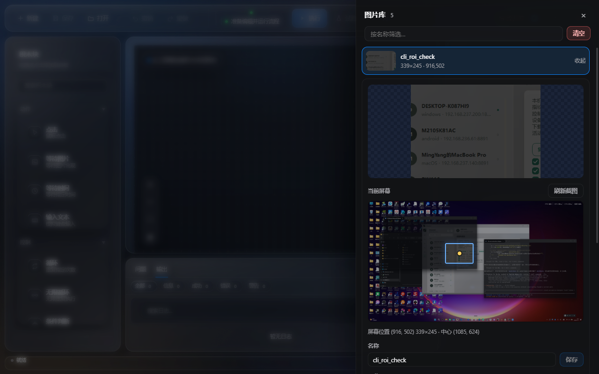
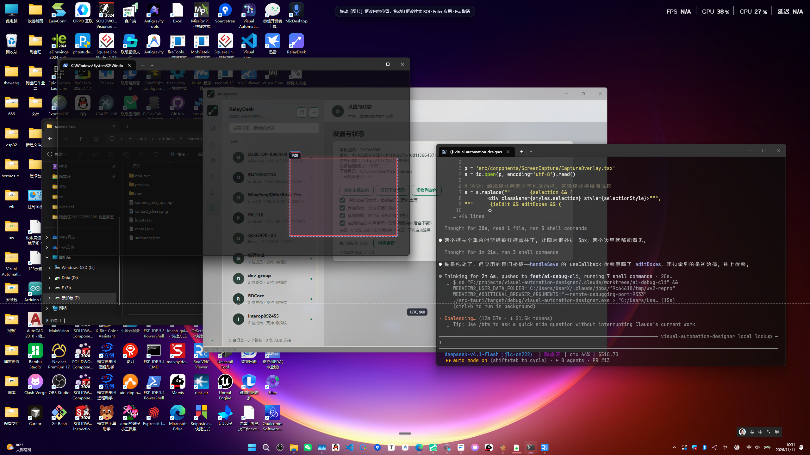

# Visual Automation Designer 使用教程

> 面向第一次打开 Visual Automation Designer 的人：从安装到跑通第一条流程，含截图与坐标/ROI 的完整用法。
> 项目地址：https://github.com/XinwangTao/visual-automation-designer



## 一、安装

### 方式一：下载安装包（推荐）

到 [Releases](https://github.com/XinwangTao/visual-automation-designer/releases) 下载对应平台的安装包：

| 平台 | 文件 |
|------|------|
| Windows 10+ | `Visual.Automation.Designer_1.0.7_x64-setup.exe` |
| macOS（Intel） | `Visual.Automation.Designer_1.0.7_x64.dmg` |
| macOS（Apple Silicon） | `Visual.Automation.Designer_1.0.7_aarch64.dmg` |
| Linux | `Visual.Automation.Designer_1.0.7_amd64.AppImage` 或 `.deb` |

macOS 首次打开若提示"无法验证开发者"，在「系统设置 → 隐私与安全性」里点「仍要打开」即可。
Linux 使用 AppImage 时先 `chmod +x` 再运行。

### 方式二：从源码构建

需要 Node.js 20+、Rust 1.80+，以及各平台的 Tauri 系统依赖（Windows 需 WebView2，Linux 需 webkit2gtk）。

```bash
git clone https://github.com/XinwangTao/visual-automation-designer.git
cd visual-automation-designer
npm install
npm run tauri dev      # 开发模式
npm run tauri build    # 打包安装包
```

首次编译 Rust 后端要几分钟，之后就快了。

## 二、界面速览

| 区域 | 作用 |
|------|------|
| 顶部工具栏 | 新建/保存/打开、撤销/重做、**执行**、试跑、单步、**图片库**、主题、帮助 |
| 左侧「积木块」 | 动作块（点击 / 等待图片 / 等待时间 / 输入文本 / 文字提取 / 截图断言）与控制块（循环 / 无限循环 / 条件 / 文字检查） |
| 中间画布 | 把积木块拖进来，从节点右侧的圆点拖到下一个节点连线；当前执行的节点会高亮 |
| 右侧「配置积木块」 | 选中节点后在这里改参数；没配好的节点会被校验器标红 |
| 底部「问题 / 输出」 | 校验结果与运行日志，失败原因也写在这里 |

## 三、建第一个流程

1. 点左侧「点击」把积木块拖到画布（也可以点一下再点画布落点）。
2. 从节点右侧圆点拖一条线到下一个积木块，形成执行顺序。
3. 选中节点，在右侧改参数；改完点「保存」（右上角会提示「有未保存的更改」）。

更完整的一条链路是「等待图片 → 点击 → 截图断言」：

- 「等待图片」：图片选目标元素，超时填 `15000`（毫秒），等到图出现在屏幕上再往下走；
- 「点击」：模式选「图片」，同样选那张图，比按坐标点更抗窗口移动；
- 「等待时间」：填 `1200`，给界面一点反应时间；
- 「截图断言」：选点击后应该出现的界面，阈值先填 `0.9`，严格模式按需勾选。

新建流程时可以直接套一个起始模板：「入门：等图 → 点击 → 等待」会连好三个节点，「带校验」那条会多加一步截图断言，选「空白流程」则从空画布开始。



点「保存流程」再点「执行流程」（或按 F5），底部日志会逐步打印每个节点开始、结束、耗时；哪一步没过去，日志里会直接写出是超时没等到图、还是断言没通过。

## 四、用图片定位：截图 → ROI → 中心坐标

这是最常用也最稳的方式：**先截一张目标的图，再记住它在哪**。

### 1. 从屏幕截取

在「点击」积木块的配置里切到「图片模式」，点「从屏幕截取」：

- 应用会**先把自己藏起来**，冻结整个桌面给你框选（所以不会截到应用自己）。
- 拖拽框选目标区域，`Enter` 保存，`Esc` 取消。
- 底部会实时显示尺寸和**屏幕绝对坐标**，例如 `220 × 130 px · 屏幕 400, 300`。



保存后这张图会进图片库，同时把「屏幕位置（ROI）」和「中心坐标」记在这张图上。

### 2. 参数说明



| 参数 | 说明 |
|------|------|
| 匹配阈值 | 0~1，默认 0.7。界面元素越稳定可以越高；画面有轻微变化就调低一点 |
| 鼠标按键 | 左键 / 右键 / 中键 |
| 识别失败时点击中心坐标（兜底） | **勾上后**，这一次匹配失败也不会让流程中断，而是直接点这张图的中心坐标（面板会显示兜底坐标是多少） |
| 点击次数 | 连续点击次数，间隔 25ms |

### 3. 测试目标

点「测试目标」会先隐藏本窗口、再截屏解析，告诉你「已找到 · 匹配 99.9% · 用时 12ms」或
「未找到 · 最高匹配 26%（阈值 70%）· 搜索区域 (x, y) 宽×高」。

> 如果报「未找到」，先看它给出的**搜索区域**——ROI 框小了或框偏了是最常见的原因。

## 五、图片库

顶部工具栏的「图片库」按钮（带数量角标）打开右侧抽屉：



- **按名称筛选**，图片多的时候先搜再用；
- 点一行展开详情：看大图、看它在**桌面上的位置**（蓝色框是 ROI，黄点是中心），
  并直接读到「屏幕位置 (x, y) 宽×高 · 中心 (cx, cy)」；
- **改名**、**改 ROI**（四个数字框）或点「在屏幕上框选」重新框一次；
- 「测试匹配」当场验证这张图现在能不能找到；
- 「删除这张」「清空」都带二次确认（清空会删掉图片文件，引用它的积木块会失效）。

## 六、在屏幕上调整（拖动已有框）

图片详情里的「**在屏幕上调整**」会把这张图的两个框直接铺在冻结的屏幕上，**不用重新框选**：



- **红框 = 搜索 ROI**：拖动它只改「去哪儿找」，图片内容不变；
- **蓝色虚线框 = 图片来源框**：拖动它会把图片**按新位置重裁**（内容和尺寸一起更新）；
- 两个框各自独立，重合时蓝色框自动外扩 3px，两个边界都看得见；
- 两个框各有 **8 个手柄**（四角 + 四边），按住可以水平/垂直拉伸；
- `Enter` 应用，`Esc` 取消；应用后想反悔，在图片库里按 **Ctrl+Z** 撤销（只保留最近一次）。
- 遮罩里按 **Ctrl+Z** 会把两个框恢复到刚打开时的位置。

## 七、节点速查

### 动作块

| 节点 | 关键参数 | 说明 |
|------|----------|------|
| 点击 | 模式（坐标 / 图片）、点击次数、阈值、兜底 | 图片模式依赖图片库里的参考图，窗口移动后仍然有效 |
| 等待图片 | 参考图、超时毫秒、阈值 | 图出现即继续，超时则流程报错停下 |
| 等待时间 | 时长毫秒 | 固定等待，适合给界面留反应时间 |
| 输入文本 | 文本内容、输入间隔毫秒 | 模拟键盘逐字输入 |
| 截图断言 | 参考图、比对阈值、严格模式、可选区域 | 用当前屏幕与参考图比对，作为“结果对不对”的判据 |
| 文本提取 | 参考图、语言 | 从指定区域识别文字，供后续判断或记录 |

### 控制块

| 节点 | 关键参数 | 说明 |
|------|----------|------|
| 循环 | 次数 | 子流程重复 N 次 |
| 无限循环 | 无 | 直到手动停止（Shift+F5），适合常驻监听 |
| 条件判断 | 参考图、条件（存在 / 不存在）、真分支、假分支 | 图在不在，决定走哪条线 |
| 文本检查 | 参考图、关键词、真分支、假分支 | 识别的文字里含不含关键词，决定走哪条线 |

分支节点的两条线要分别连到各自的第一个节点，没连的分支在执行时会被跳过。

## 八、运行与调试

- **执行**：从起点开始跑整个流程。运行时主窗口会自动最小化，避免挡住要点的目标；跑完自动还原。
- **试跑**：只解析目标、不点击不输入，用来检查配置。
- **单步**：一次执行一个积木块（F10）。
- 运行过程中的结果都在底部「输出」里；「问题」页会列出校验错误。
- 流程跑不通先看日志里的第一条错误，而不是最后一条——后面的失败往往是前面某步没做成的连锁反应。
- 「等待图片」超时通常有三种原因：参考图截得太大（背景变化导致匹配失败）、界面还没加载出来（把超时调大）、缩放比例变了（重新截图）。

## 九、让 AI 直接调用

同一条执行核心还提供两个无头程序，供脚本和 AI Agent 使用：

```bash
# 截一块屏幕区域并拿到图片 + ROI + 中心点
vadctl capture-image --name 保存按钮 --roi 1800,1320,160,48

# 在当前屏幕上找模板（可限定 ROI）
vadctl find --template 保存按钮 --threshold 0.8

# 只解析不点击，或直接点
vadctl click-target --template 保存按钮 --dry-run
vadctl click-target --coords 100,200
```

MCP 侧对应 `vad_capture` / `vad_find` / `vad_click_target` 等工具（`vad-mcp`）。

更多命令行参数见 `vadctl --help`，AI 侧的完整说明见 [AI_AGENT_PLAYBOOK.md](AI_AGENT_PLAYBOOK.md)。

## 十、快捷键

| 快捷键 | 功能 |
|--------|------|
| Ctrl/Cmd + N | 新建流程 |
| Ctrl/Cmd + S | 保存流程 |
| Ctrl/Cmd + O | 打开流程列表 |
| Ctrl/Cmd + Z | 撤销 |
| Ctrl/Cmd + Y 或 Ctrl/Cmd + Shift + Z | 重做 |
| Delete / Backspace | 删除选中节点或连线 |
| F5 | 执行流程 |
| Shift + F5 | 停止执行 |
| F10 | 单步执行 |

## 十一、常见问题

**Q：截图时窗口不见了？**
A：是故意的——截屏前会隐藏主窗口 200ms 再冻结桌面，保证截图里没有本应用。

**Q：为什么"找不到图片"但屏幕上明明有？**
A：按顺序检查：① 「测试目标」给出的搜索区域是否覆盖目标；② 阈值是否过高；
③ 目标是不是被别的窗口挡住（运行时主窗口会自动最小化，但其它窗口不会）。

**Q：图片库里的"未设 ROI"是什么意思？**
A：这张图还没有记录屏幕位置（比如上传/粘贴进来的）。给积木块设了 ROI 就不影响；
想让"块没设 ROI"时也能快速定位，就在图片库里补一个。

**执行时坐标点偏了**：多半是显示器缩放（DPI）不一致。本项目会自动检测缩放比例并纠正坐标映射；如果仍然偏，检查是否在远程桌面里运行——远程会话的 DPI 和本机可能不同。

**点击没有反应**：先确认目标窗口是前台且没有被系统权限拦住。Windows 上部分以管理员权限运行的窗口，普通权限的模拟点击会被丢弃。

**流程文件在哪**：Windows 在 `%APPDATA%\com.visualautomation.designer\flows.json`，macOS 在 `~/Library/Application Support/com.visualautomation.designer/flows.json`，Linux 在 `~/.local/share/com.visualautomation.designer/flows.json`。备份这个文件就等于备份了所有流程。

**能跑在后台吗**：不能。自动化依赖真实屏幕内容，窗口被最小化或屏幕锁定时截图会失败。

**Q：执行时窗口最小化了，怎么停止？**
A：点任务栏恢复窗口后点「停止」；或者让流程自己跑完。

## 十二、参与贡献

- 发现 bug 或有功能建议，直接开 Issue，附上平台、版本和日志里的错误行。
- 提交代码前请本地跑通 `npm run lint`、`npm test`、`npm run build`，CI 会做同样的检查。
- 架构与模块职责见 [ONBOARDING.md](./ONBOARDING.md)，Tauri 命令清单见 [API.md](../API.md)。
